# 🤖 Projeto Agentes IA Econômicos


## 📌 Objetivo do Projeto

O **Projeto Agentes IA Econômicos** foi desenvolvido com o objetivo de automatizar a coleta, análise e apresentação de informações econômicas e financeiras utilizando Inteligência Artificial.

A aplicação integra diferentes fontes de dados, como indicadores econômicos, cotações da Bolsa de Valores (B3) e notícias do mercado financeiro. Após a coleta, essas informações são processadas por Agentes de IA desenvolvidos com CrewAI e OpenAI, responsáveis por interpretar os dados e gerar insights que auxiliam na tomada de decisão.

Além disso, o projeto disponibiliza um dashboard interativo desenvolvido com Streamlit, permitindo a visualização dos dados e das análises produzidas pelos agentes.

---

# 🌎 Aplicação no Mundo Real

Projetos semelhantes são utilizados por instituições financeiras, bancos, corretoras, empresas de investimentos e consultorias para monitorar o mercado financeiro em tempo real.

Essas soluções automatizam a coleta de dados provenientes de APIs e fontes públicas, processam grandes volumes de informações e utilizam Inteligência Artificial para gerar análises que apoiam investidores, analistas e gestores na tomada de decisões estratégicas.

Este projeto simula esse fluxo de trabalho em uma arquitetura local, aplicando conceitos amplamente utilizados em Engenharia de Dados, IA Generativa e Analytics.

---

# 🛠️ Tecnologias Utilizadas

Este projeto foi desenvolvido utilizando tecnologias voltadas para Engenharia de Dados, Inteligência Artificial e desenvolvimento de aplicações web. Abaixo estão as principais ferramentas utilizadas e suas respectivas funções:

- **Python** — Linguagem utilizada no desenvolvimento da aplicação.
- **CrewAI** — Framework para criação e orquestração dos Agentes de IA.
- **OpenAI** — Modelo de IA responsável pela geração de análises e insights.
- **LangChain** — Integra os modelos de linguagem e organiza os fluxos de IA.
- **Streamlit** — Desenvolvimento do dashboard interativo.
- **Pandas** — Manipulação e tratamento dos dados.
- **Plotly** — Criação de gráficos interativos.
- **BeautifulSoup** — Extração de informações por Web Scraping.
- **Requests** — Consumo de APIs e requisições HTTP.
- **Python Dotenv** — Gerenciamento das variáveis de ambiente.
- **Git** — Controle de versão do projeto.
- **GitHub** — Hospedagem e versionamento do código-fonte.

---

# 🏗️ Arquitetura do Projeto

```text
           Fontes de Dados

 ┌─────────────────────────────────────┐
 │ BACEN │ Alpha Vantage │ Notícias │
 └─────────────────────────────────────┘
                 │
                 ▼
       Scripts de Coleta (Python)
                 │
                 ▼
         Armazenamento Local
              (Pasta data)
                 │
                 ▼
      Agentes de IA (CrewAI + OpenAI)
                 │
                 ▼
        Geração de Insights Econômicos
                 │
                 ▼
        Dashboard Interativo Streamlit
```

# Uma das páginas utilizadas para API:

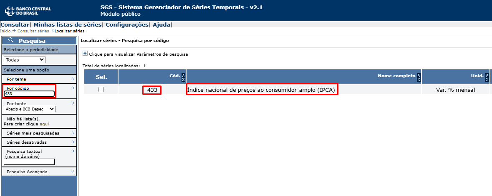


---

# 📂 Estrutura do Projeto

```text
Projeto_agentes_IA_economicos/

├── data/
│
├── scripts/
│   ├── indicadores_economicos.py
│   ├── acoes.py
│   ├── noticias.py
│   └── agentes_economicos.py
│
├── main/
│   └── main.py
│
├── streamlit/
│   ├── dashboard.py
│   └── config.toml
│
├── requirements.txt
├── requirements-lock.txt
├── .env
├── .gitignore
├── .python-version
└── README.md
```

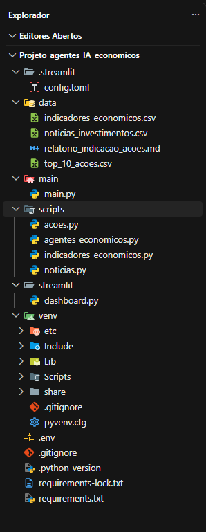

---


# Ativando o .venv antes de começar o Projeto:

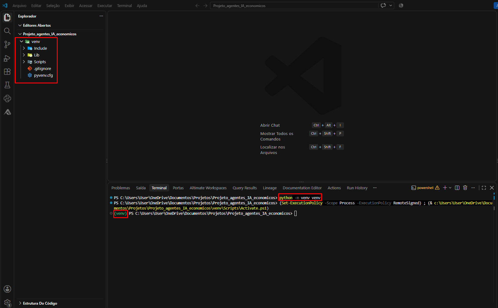

---

# 📁 Estrutura das Pastas


## 📂 data/

Responsável por armazenar todos os dados coletados durante a execução do projeto.

Nesta pasta são gravados arquivos contendo:

- Indicadores econômicos do BACEN;
- Cotações de ações da B3;
- Notícias coletadas por Web Scraping;
- Informações utilizadas pelos Agentes de IA durante as análises.

Essa separação permite reutilizar os dados sem realizar novas consultas às APIs.


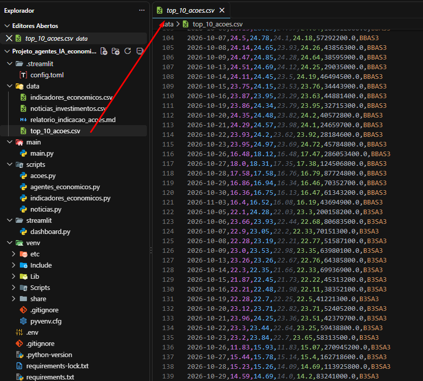


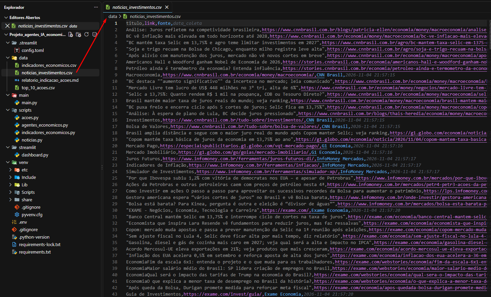

---

## 📂 scripts/

Reúne todos os scripts responsáveis pela coleta, processamento e preparação dos dados.

### indicadores_economicos.py

Realiza a consulta da API do Banco Central do Brasil (BACEN), coletando indicadores econômicos utilizados nas análises.

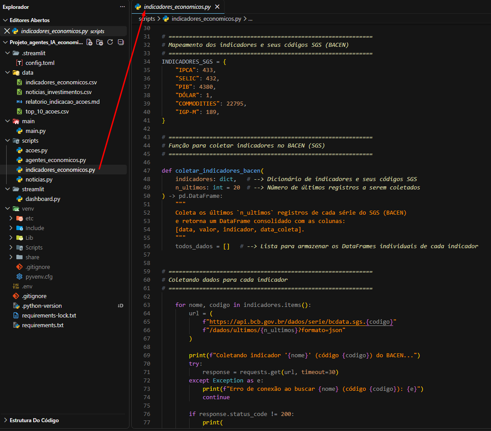

---

### acoes.py

Responsável pela coleta das cotações das principais ações da Bolsa de Valores (B3) utilizando APIs financeiras.

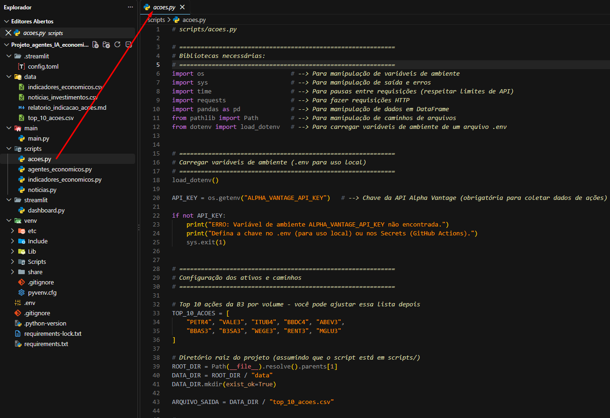

---

### noticias.py

Executa o processo de Web Scraping em sites especializados, coletando notícias relacionadas ao mercado financeiro e economia.

Entre as fontes utilizadas estão:

- CNN Brasil
- G1 Economia
- InfoMoney
- Exame


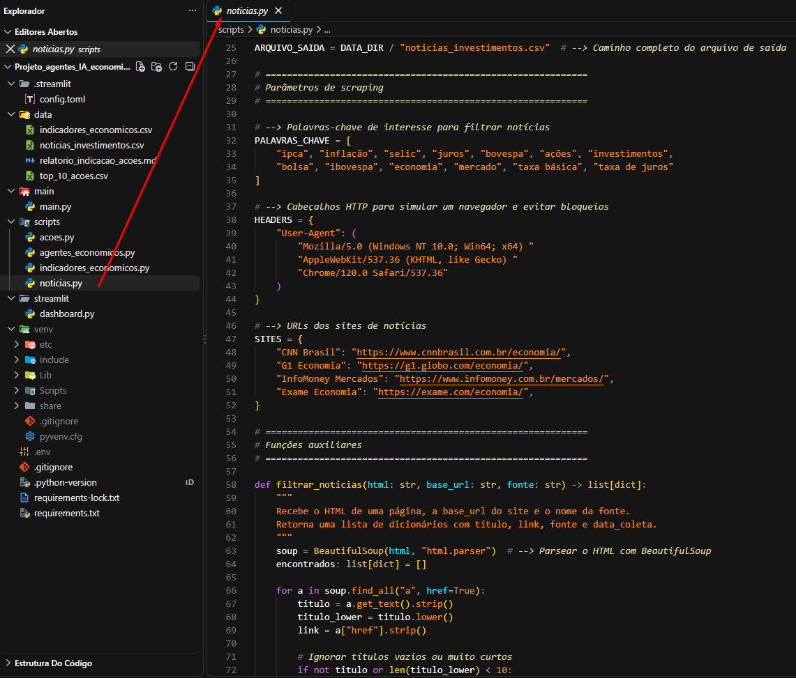

---

### agentes_economicos.py

Define os Agentes de Inteligência Artificial utilizando CrewAI.

Neste módulo são configurados:

- Papéis dos agentes;
- Objetivos;
- Responsabilidades;
- Engenharia de Prompt;
- Fluxo das análises.

Após receberem os dados coletados, os agentes interpretam as informações e produzem insights econômicos.

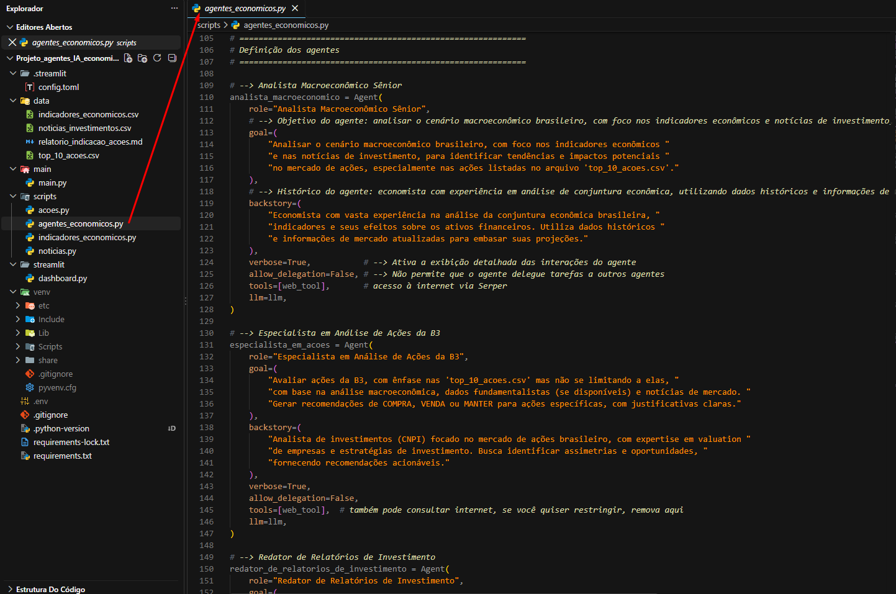

---

## 📂 main/

Contém o responsável pela orquestração do projeto.

### main.py

Executa todo o pipeline da aplicação, realizando:

- Coleta dos indicadores econômicos;
- Coleta das ações;
- Coleta das notícias;
- Execução dos Agentes de IA;
- Inicialização do Dashboard Streamlit.

Funciona como o ponto central da aplicação, coordenando todas as etapas do processo.

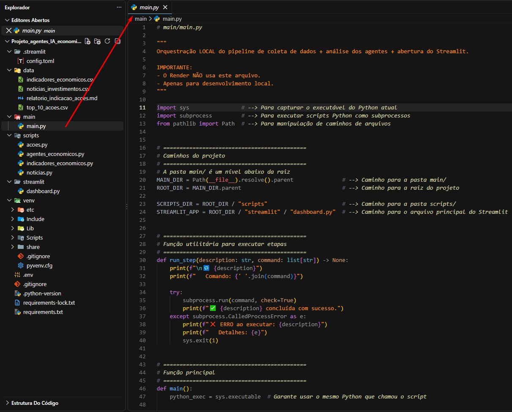

---

## 📂 streamlit/

Responsável pela interface gráfica do projeto.

### dashboard.py

Desenvolve o dashboard interativo que apresenta os dados coletados e os insights produzidos pelos agentes.

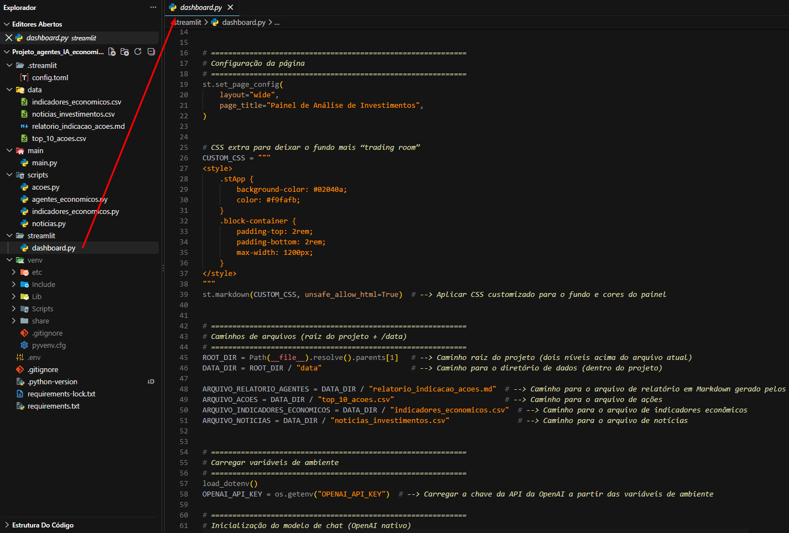

---

### config.toml

Arquivo de configuração do Streamlit utilizado para personalizar o comportamento da aplicação.

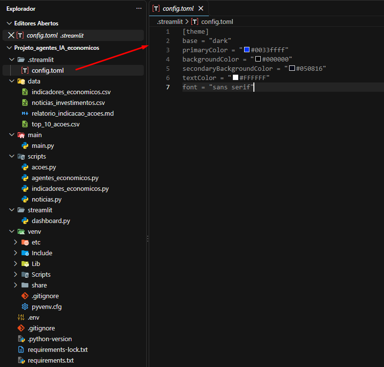

---

## 📄 requirements.txt

Lista todas as bibliotecas necessárias para executar o projeto.

Instalação:

```bash
pip install -r requirements.txt
```

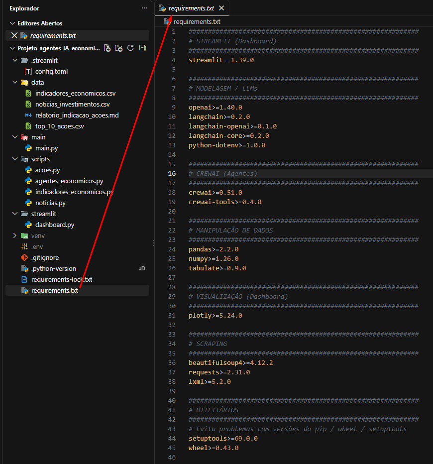

---

## 📄 requirements-lock.txt

Armazena as versões exatas das bibliotecas instaladas, garantindo reprodutibilidade do ambiente.

---

## 📄 .env

Contém as variáveis de ambiente utilizadas pelo projeto, como chaves de APIs e outras configurações sensíveis.


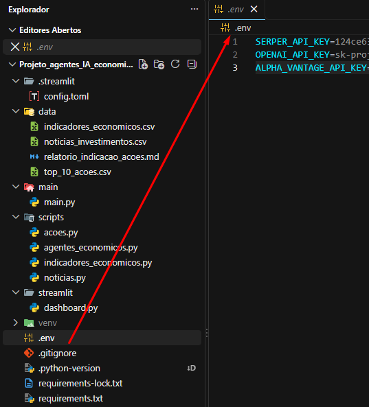

---

## 📄 .gitignore

Define arquivos e diretórios que não devem ser enviados ao GitHub, como ambiente virtual, caches e variáveis de ambiente.

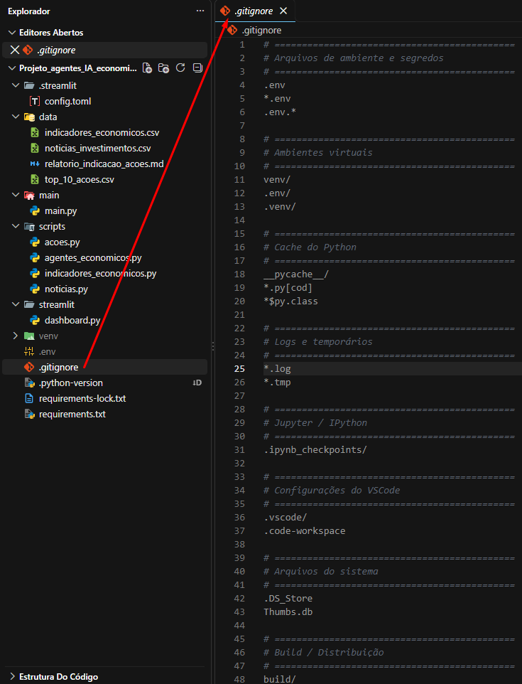

---

## 📄 .python-version

Especifica a versão do Python utilizada durante o desenvolvimento.

---

# ⚙️ Fluxo do Projeto

O pipeline executa as seguintes etapas:

1. Coleta automática dos indicadores econômicos disponibilizados pelo BACEN.

2. Coleta das cotações das principais ações negociadas na B3 através de APIs financeiras.

3. Extração de notícias econômicas utilizando técnicas de Web Scraping.

4. Armazenamento dos dados coletados na pasta **data**.

5. Processamento das informações pelos Agentes de IA desenvolvidos com CrewAI e OpenAI.

6. Geração de análises e insights baseados nos dados coletados.

7. Apresentação dos resultados em um dashboard interativo desenvolvido com Streamlit.

---

# 🤖 Agentes de IA

O projeto utiliza Agentes de Inteligência Artificial desenvolvidos com CrewAI para automatizar a análise das informações econômicas.

Cada agente possui um papel específico, definido por meio de técnicas de Engenharia de Prompt, permitindo uma divisão organizada das responsabilidades.

Esses agentes recebem os dados coletados, interpretam o contexto econômico e produzem análises que auxiliam na compreensão do cenário financeiro.

---

# 📊 Dashboard

O dashboard foi desenvolvido utilizando Streamlit para disponibilizar uma interface simples e intuitiva.

Através dele é possível visualizar:

- Indicadores econômicos;
- Informações do mercado financeiro;
- Dados coletados pelas APIs;
- Insights gerados pelos Agentes de IA.
  
---


---

# ▶️ Como Executar

### 1. Clone o repositório

```bash
git clone <URL_DO_REPOSITORIO>
```

### 2. Acesse a pasta do projeto

```bash
cd Projeto_agentes_IA_economicos
```

### 3. Crie e ative o ambiente virtual

```bash
python -m venv venv
```

Windows

```bash
venv\Scripts\activate
```

Linux/Mac

```bash
source venv/bin/activate
```

### 4. Instale as dependências

```bash
pip install -r requirements.txt
```

### 5. Configure as variáveis de ambiente

Crie o arquivo `.env` contendo as chaves das APIs utilizadas pelo projeto.

### 6. Execute o pipeline

```bash
python main/main.py
```

### 7. Execute o dashboard

```bash
streamlit run streamlit/dashboard.py
```

---

# 🎯 Principais Conceitos Aplicados

- **Engenharia de Dados** — Coleta, organização e processamento de dados para análise.
- **Inteligência Artificial Generativa** — Utilização de modelos de IA para gerar respostas e insights.
- **Agentes de IA** — Agentes especializados que analisam dados e executam tarefas específicas.
- **CrewAI** — Framework para criação e orquestração dos agentes de IA.
- **LangChain** — Biblioteca para integração e gerenciamento dos fluxos com modelos de linguagem.
- **OpenAI** — Modelo de linguagem utilizado para interpretar informações e gerar análises.
- **Engenharia de Prompt** — Criação de instruções que orientam o comportamento dos agentes de IA.
- **Consumo de APIs** — Obtenção de dados por meio de serviços e APIs externas.
- **Web Scraping** — Coleta automatizada de informações disponíveis em páginas da web.
- **Automação de Processos** — Execução automática das etapas do pipeline de dados.
- **Visualização de Dados** — Apresentação dos resultados por meio de dashboards e gráficos.
- **Python** — Linguagem principal utilizada no desenvolvimento do projeto.
- **Streamlit** — Framework para criação da interface web interativa.
- **Git e GitHub** — Controle de versão e hospedagem do código-fonte.

---

# 📈 Resultado

O projeto demonstra a construção de uma solução capaz de integrar diferentes fontes de dados econômicos, automatizar sua coleta e utilizar Inteligência Artificial para gerar análises e insights.

Além de consolidar conhecimentos em Python, APIs, Web Scraping e IA Generativa, o projeto aplica conceitos modernos de Engenharia de Dados e Analytics, simulando um fluxo utilizado em empresas para monitoramento de indicadores econômicos, análise de mercado e apoio à tomada de decisão.
